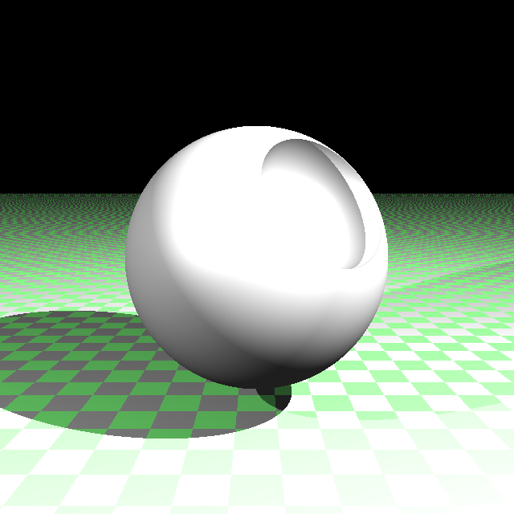
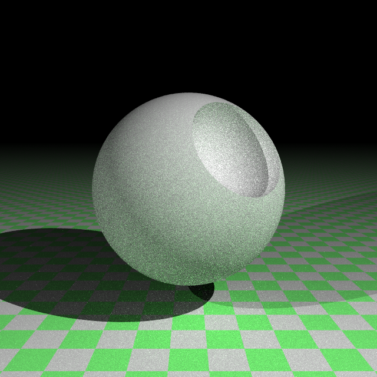
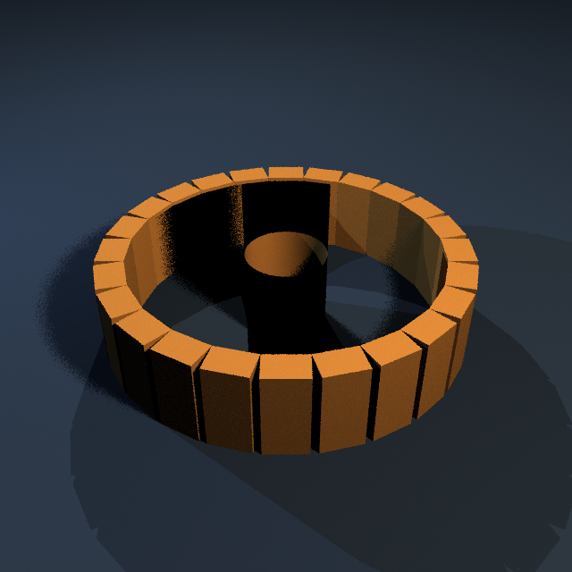
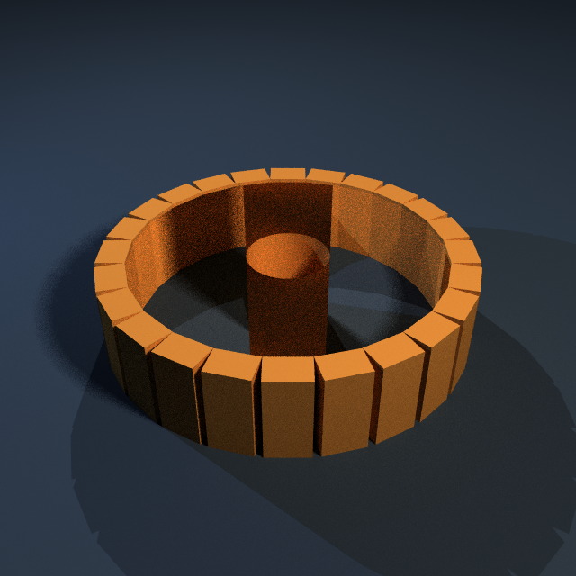
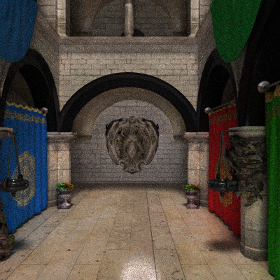
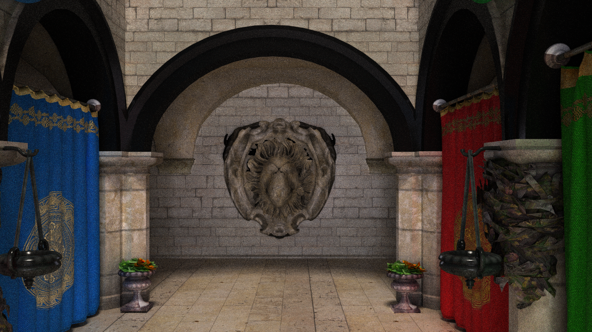
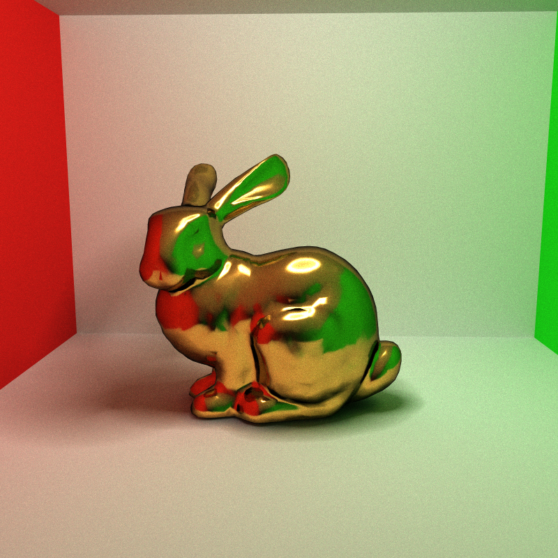

hairy-tracer
============

A raytracer that was originally written in Python in 2010 for a Computer Graphics class. It used to be really slow, but it's not so slow anymore.

**Engine Status (August 2026):**
The core rendering engine has been completely ported to Rust (`hairy-tracer-core`) for massive performance gains and new features (Fresnel reflection, volumetric absorption, depth of field, environment maps, procedural/image texturing, anti-aliasing).
- **Rust is now the primary, actively developed engine.** It is used by default.
- The original pure-Python engine is retained under the `--pure-python` flag as an unmaintained historical reference only. It lacks the advanced physical accuracy and features of the Rust core.

Bear in mind the following:
1. While it's not cutting edge, it mostly works.
2. It's incredibly fast now thanks to Rust.
3. It's actively being improved again.


## Performance Benchmarks

The transition from pure Python to Rust provided massive speedups (250x to 450x faster) for the base Whitted raytracer, entirely transforming what the engine is capable of rendering. 

For an 800x800 resolution image:

**Benchmark 1: Simple Spheres (`scenes/whitted/legacy/spheres3.json`)**
* **Python Engine:** 9.40 seconds
* **Rust Engine:** 0.02 seconds
* *Result: ~447x faster*

**Benchmark 2: 3D Mesh & AABB (`scenes/whitted/legacy/mesh_test.json`)**
* **Python Engine:** 22.83 seconds
* **Rust Engine:** 0.08 seconds
* *Result: ~260x faster*

Because of this performance leap, the engine can now comfortably evaluate complex multi-million ray scenes involving Path Tracing, Constructive Solid Geometry, and Global Illumination in a matter of minutes.

Here are some sample renders:









I put this online as a starting point to start working on it again. And just maybe, someone out there 
might be interested in working on it too.

- 9 October 2014
- Updated 22 August 2026

## Capabilities & Scene Taxonomy

The repository's scenes are organized by the specific set of capabilities they test and demonstrate. 

* **`scenes/whitted/legacy/`**: Classic recursive ray tracing (the original Whitted integrator) without any modern opt-in features.
* **`scenes/whitted/featured/`**: Whitted integrator with sampling features enabled (Anti-Aliasing, Soft Shadows, Depth of Field, etc.).
* **`scenes/path_trace/diffuse/`**: Path tracing for global illumination, focusing on diffuse surfaces and color bleeding.
* **`scenes/path_trace/pbr/`**: Advanced path tracing featuring Physically Based Rendering (PBR), GGX Microfacet specular, and Next Event Estimation.
* **`scenes/stress/`**: Scenes meant for profiling Bounding Volume Hierarchy (BVH) and engine performance.

## Installation & Setup

You can build and run `hairy-tracer` as a **100% standalone Rust CLI (`htrace`)** with zero Python dependencies, or install the Python bindings via `maturin`.

### Option A: Pure-Rust CLI (`htrace`) — Recommended

All you need is a standard **Rust** toolchain (`cargo`):

```bash
cargo build --release --manifest-path hairy-tracer-core/Cargo.toml --bin htrace
```

The compiled binary will be located at `./hairy-tracer-core/target/release/htrace`. It accepts both `.json` and `.dsl` scene files directly and outputs `.bmp` or `.png` images.

### Option B: Python Bindings (`btrace.py`)

If you want to use the Python CLI wrapper (`src/btrace.py`) or run `--pure-python` benchmarks, you will need **Python 3.10+** and **Rust**:

**1. Setup Python Environment & Dependencies**:
```bash
python3 -m venv env
source env/bin/activate
pip install maturin pillow numpy
```

**2. Build the Rust Python Extension**:
From the root of the repository:
```bash
maturin develop --release
```

## How to Render

You can render any scene using the pure-Rust `htrace` binary (or `python src/btrace.py` with the same flags):

```bash
./hairy-tracer-core/target/release/htrace --scene scenes/path_trace/pbr/bunny_cornell.json --size 800x800 --outfile output.png
```

`htrace` also compiles and renders `.dsl` (Scene DSL) files directly on the fly without needing a separate compilation step:

```bash
./hairy-tracer-core/target/release/htrace --scene scenes/showcase_dice_craps.dsl --size 800x800 --outfile craps.png
```

### Showcase Scene Recipes

* **Stanford Bunny (PBR Path Tracing & GGX Specular):**
  ```bash
  ./hairy-tracer-core/target/release/htrace --scene scenes/path_trace/pbr/bunny_cornell.json --size 800x800 --outfile bunny.png
  ```
* **Crytek Sponza Atrium (262k-Triangle Mesh, Textures & Global Illumination):**
  ```bash
  ./hairy-tracer-core/target/release/htrace --scene scenes/path_trace/pbr/sponza.json --size 800x800 --outfile sponza.png
  ```
* **Constructive Solid Geometry (Death Star & Mechanical Gear):**
  ```bash
  ./hairy-tracer-core/target/release/htrace --scene scenes/csg_death_star.json --size 800x800 --outfile death_star.png
  ./hairy-tracer-core/target/release/htrace --scene scenes/gear.dsl --size 800x800 --outfile gear.png
  ```
* **Flagship Craps & Showcase Dice (CSG + Depth of Field + HDR Environment Map):**
  ```bash
  ./hairy-tracer-core/target/release/htrace --scene scenes/showcase_dice_craps.dsl --size 800x800 --outfile craps.png
  ./hairy-tracer-core/target/release/htrace --scene scenes/showcase_dice.dsl --size 800x800 --outfile dice_red.png
  ./hairy-tracer-core/target/release/htrace --scene scenes/showcase_dice_ivory.dsl --size 800x800 --outfile dice_ivory.png
  ```

### Compiling Scene DSL (`.dsl`) Files

Complex CSG and hierarchical scenes are authored in the custom Scene DSL (`scenes/*.dsl`) and compiled to JSON using the `scene_dsl` compiler crate:

```bash
cargo run --manifest-path scene_dsl/Cargo.toml -- compile scenes/showcase_dice_craps.dsl -o scenes/showcase_dice_craps.json
```

### Reproducing the Python vs. Rust Benchmarks

To compare the Rust engine against the legacy 2010 pure-Python engine on classic Whitted scenes, pass `--pure-python`:

```bash
# Rust engine (~0.02s)
python src/btrace.py --scene scenes/whitted/legacy/spheres3.json --size 800x800 --outfile rust_spheres.bmp

# Legacy pure-Python engine (~9.40s)
python src/btrace.py --pure-python --scene scenes/whitted/legacy/spheres3.json --size 800x800 --outfile py_spheres.bmp
```

### Batch Rendering Scripts

You can render entire categories of scenes using the provided helper scripts:

* **Classic / Whitted Scenes**: `bash scripts/render_all.sh [resolution]` (e.g. `bash scripts/render_all.sh 400x400`)
* **Path Traced Scenes**: `bash scripts/run_pt_scenes.sh` (renders at 400x400)
